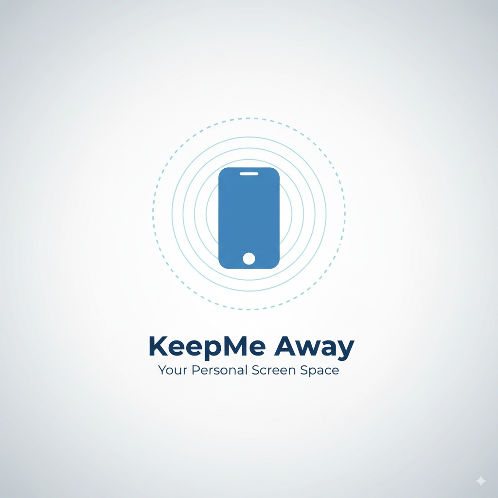

	

<h1 align="center">KeepMe Away</h1>

Your personal screen space. Keep a healthy distance from the display — all processing stays on your device. 🔒📵

---

## Why use it? 💡

- 👀 Reduce eye strain and fatigue
- 🧒 Encourage healthy screen habits for kids
- 📚 Help students maintain good posture while studying
- 📱 For heavy phone users who sit too close without noticing

## What it does 🛡️

- Uses the front camera and the **distance between your eyes** to estimate how close you are
- Shows a countdown warning, then (on Android) blocks the screen until you sit back
- Works entirely offline and on-device — frames are never saved or sent anywhere

## Key features ✨

- 🔍 On-device proximity from BlazeFace eye keypoints (privacy-first)
- 🎯 One-time calibration at your comfortable viewing distance
- ⏱️ Full-screen countdown, then a protective overlay (Android)
- 🧩 Sensitivity and warning time you can actually understand
- 📊 Warnings, blocks, and protected time — including a 7-day view
- ⚡ Lightweight and battery-friendly

## Privacy first 🔒

- 100% on-device processing with an open-source model (MediaPipe BlazeFace, Apache 2.0)
- No photos or video are stored
- No data is transmitted; internet is not required
- No proprietary dependencies — fully FOSS-compliant

## Get the app ⬇️

Go to the Releases page of this repository and download the latest APK for your device:

- arm64-v8a (most modern Android phones)
- armeabi-v7a (older devices)
- x86_64 (emulators)

Then install the APK on your Android device.

## Quick start 🚀

1. Install and open the app
2. Grant Camera permission (and Overlay permission on Android)
3. Sit at a comfortable distance, face the camera, and calibrate
4. Tap **Start protection** — you can leave the app; it keeps watching in the background

## How distance is measured

KeepMe Away does **not** use a face bounding box. After BlazeFace finds your face, it reads the left and right eye points and uses the gap between them (inter-ocular distance).

That gap grows as you lean in (`distance ∝ 1 / eye gap`). You calibrate once at a distance that feels easy on your eyes; the app warns when you sit a set percentage closer than that.

Both eyes need to be visible and roughly facing the camera. Turning your head far to one side can pause detection until you look back.

## Permissions explained (Android) 🔐

- **Camera:** measure the distance between your eyes on-device
- **Display over other apps:** show the countdown and block overlay
- **Notifications:** keep the protection service visible in the background
- **Ignore battery optimizations** (optional): more reliable when the app is minimized

## Settings ⚙️

- **Sensitivity:** how much closer than calibrated distance triggers a warning
- **Warning time:** seconds of countdown before the screen is blocked
- **Haptic feedback:** vibrate when a warning starts
- **Advanced:** stability gap (anti-flicker) and face-confidence threshold

## Statistics

While protection is on, the app records warnings, blocks, and minutes protected. The Statistics screen shows today, the last 7 days, and a safe-distance score based on warnings per protected hour.

## Supported platforms 📱

- Android 7.0+ fully supported (foreground service + overlay)
- iOS builds exist, but overlay protection is Android-only

## Troubleshooting 🧰

- **Not detecting you?** Use good lighting, look at the front camera, and keep both eyes in view
- **Calibration failed?** Sit still at a normal reading distance and retry
- **Overlay didn’t appear?** Grant “Display over other apps”
- **Stops in the background?** Disable battery optimizations for the app
- **After updating from an older version?** Calibrate again — distance is no longer based on face-box size

## FAQ ❓

- **Does the app record or upload video?** No. It processes frames on-device and discards them
- **Does it work offline?** Yes
- **Battery impact?** Low — frames are throttled and skipped when you are sitting still
- **Can it measure exact centimetres?** No. It compares your current eye gap to the one you calibrated

## Contribute 🤝

Issues and PRs are welcome. Ideas: improved UX, accessibility, localization, scheduled protection.

## License 📄

MIT — see [LICENSE](LICENSE).
